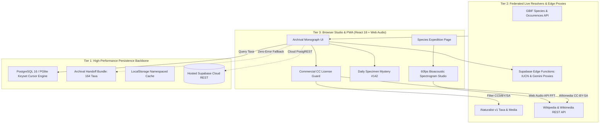

# ANIMALIA — The Archival Field Monograph of the Animal Kingdom

<div align="center">

```
     /\_/\      ___   _   _ _____ __  __    _    _     ___    _    
    ( o.o )    / _ \ | \ | |_   _|  \/  |  / \  | |   |_ _|  / \   
     > ^ <    / /_\ \|  \| | | | | |\/| | / _ \ | |    | |  / _ \  
   (  (_)  ) / /_   \ \ |\  | | | | |  | |/ ___ \| |___ | | / ___ \ 
    \_____/ /_/  \_\_\|_| \_| |_| |_|  |_/_/   \_\_____|___/_/   \_\
```

**A museum-grade digital natural history monograph, bioacoustic laboratory, and taxonomic discovery platform.**

[](https://www.typescriptlang.org/)
[](https://react.dev/)
[](https://vitejs.dev/)
[-336791.svg?style=flat-square&logo=postgresql)](https://www.postgresql.org/)
[](https://web.dev/progressive-web-apps/)
[](LICENSE)
[](GEMINI.md)

[**Live Demo**](https://animalia-monograph.vercel.app) • [**Quickstart**](#-quickstart-in-60-seconds) • [**Architecture**](#-system-architecture) • [**Features**](#-flagship-features) • [**Contributing**](CONTRIBUTING.md)

</div>

---

## 🏛️ Overview

**ANIMALIA** reimagines historical zoological plates (such as Ernst Haeckel’s *Kunstformen der Natur* and Audubon’s *Birds of America*) as an archival, high-performance web platform.

Engineered with uncompromising scientific rigor under the **GEMINI.md Scientific Integrity Rules**, ANIMALIA unites local embedded SQL databases, live federated biodiversity networks (GBIF, iNaturalist, Wikimedia Commons, IUCN Red List), and Web Audio API signal processing into an interactive monograph.

Whether hosted locally via an embedded **PGlite** socket server or deployed globally on serverless static edge clouds (**Vercel, Cloudflare Pages, Netlify, Supabase Cloud**), ANIMALIA guarantees zero console errors, instant offline availability, and commercial-safe media provenance.

---

## 🏗️ System Architecture

ANIMALIA operates on a **3-Tier Hybrid Biodiversity Engine** combining an authoritative PostgreSQL backbone, real-time live federated resolvers, and client-side digital signal processing.



---

## 🌟 Flagship Features

| Capability | Technical Implementation | Highlights |
| :--- | :--- | :--- |
| **Species Expedition Page** | Multi-view layout (Overview, Distribution, Theatre, Monograph Dossier) with full keyboard accessibility (`Esc`, `←`, `→`, `⌘K`) | Morphometric scale seesaw vs 1.75m human silhouette, 24-hr circadian solar clock with interactive scrubber, 3D taxonomic card flipping. |
| **60fps Bioacoustic Studio** | Web Audio API dual-buffer FFT Fast Fourier Transform analyzer with canvas visualizer | Real-time audio waveform, high-frequency call detection, and slow-motion pitch-drop playback (0.25x, 0.5x, 1.0x). |
| **Daily Specimen Mystery** | Deterministic UTC date-seeded pseudorandom selection with epoch day counter | Clade warm/cold taxonomic feedback (Phylum through Genus), spoiler-redaction engine, and Wordle-style shareable field dispatches. |
| **Commercial-Safe CC License Guard** | Real-time license evaluator (`isCommercialSafeLicense`) with UI telemetry toggle | Filters iNaturalist and Wikimedia photography to strictly permit `CC0`, `CC-BY`, `CC-BY-SA`, `PD`; auto hot-swaps `-NC` seed images on the fly. |
| **Archival Monograph Exporter** | Print-isolated CSS stylesheets (`@media print`) and CORS-resilient HTML5 Canvas | Export high-resolution Linnaean monograph plates as print-ready museum PDF dossiers or download specimen cards as `.png`. |
| **Zero-Error Cloud Fallback** | Hybrid data provider (`SupabaseBiodiversityRepository`) with PostgREST & bundled fallback | Runs seamlessly on Vercel/Netlify without local port 54322, loading 164 verified taxa with sub-millisecond keyset cursor seek. |
| **Progressive Web App (PWA)** | Web App Manifest (`manifest.webmanifest`) in **Obsidian Herbarium (`#070A09`)** | Native installability on iOS, Android, macOS, and Windows with custom golden botanical crest icons and standalone app experience. |

---

## ⚡ Quickstart in 60 Seconds

### Option 1: Native 1-Click Launch (Windows)

Double-click `launch.bat` in the root folder, or execute:

```cmd
launch.bat
```

This starts the embedded PGlite PostgreSQL database server on port `54322`, compiles the TypeScript engine, and launches Vite at `http://localhost:5173`.

### Option 2: Cross-Platform NPM Start (macOS, Linux, Windows)

```bash
# 1. Install dependencies
npm install

# 2. Launch platform (runs database server + frontend concurrently)
npm start
```

Visit [`http://localhost:5173`](http://localhost:5173).

---

## ☁️ Cloud & Production Deployment

ANIMALIA is built for static edge hosting with zero backend server requirements.

### Deploying to Vercel

[](https://vercel.com/new/clone?repository-url=https://github.com/example/animalia)

1. Push your repository to GitHub.
2. Import the project in Vercel.
3. Vercel automatically detects `vercel.json` (providing single-page app rewrites and immutable cache headers).
4. Build command: `npm run build`
5. Output directory: `dist`

### Connecting Hosted Supabase Cloud (Optional)

To connect ANIMALIA to a remote hosted Supabase PostgreSQL project:

1. Create a Supabase project at [supabase.com](https://supabase.com).
2. Execute the migration scripts in `supabase/migrations/`:
   - `001_animalia_biodiversity_backbone.sql`
   - `002_engagement_and_collections.sql`
   - `003_keyset_cursor_pagination.sql`
3. Add environment variables to your deployment (`.env` or Vercel Environment Variables):

```env
VITE_SUPABASE_URL=https://your-project.supabase.co
VITE_SUPABASE_ANON_KEY=your-anon-key
VITE_COMMERCIAL_SAFE_MEDIA=true
```

If these environment variables are omitted, ANIMALIA automatically operates in **Cloud Serverless Mode** using the pre-verified 164-species handoff bundle with zero errors.

---

## 🔬 Scientific Integrity Rules (`GEMINI.md`)

ANIMALIA strictly enforces the four non-negotiable laws of scientific integrity:

1. **Zero Fabricated Biology**: Measurements, diets, lifespans, and IUCN statuses are never invented. Unverified fields remain `null` and render in the UI as *"Not yet documented in available source record"*.
2. **Strict Image Provenance**: Every photograph displays its source URL, author attribution, and Creative Commons license code (`CC0`, `CC-BY`, `CC-BY-SA`, `CC-BY-NC`).
3. **Data Source Transparency**: Every specimen record explicitly declares its provenance: `LOCAL_DEMO_RECORD`, `IMPORTED_REPOSITORY_RECORD`, `LIVE_API_RESULT`, or `CACHED_RECORD`.
4. **No Decorative Controls**: Every search filter, comparison slot, and collection button performs authentic state transitions and database queries.

---

## 🧪 Comprehensive E2E Verification Suites

ANIMALIA ships with 6 automated end-to-end test suites:

```bash
# 1. Commercial License Guard & PWA Launch Readiness Suite
node scripts/verify-launch-readiness-e2e.js

# 2. Comprehensive Platform Production Suite (90 Checks)
node scripts/verify-animalia-e2e.js

# 3. Species Expedition Page & Interactive Modules Suite (34 Checks)
node scripts/verify-expedition-e2e.js

# 4. 60fps Bioacoustic Engine & Audio Studio Suite (6 Checks)
node scripts/verify-bioacoustics-e2e.js

# 5. Multi-Image & Gallery Expansion Suite (6 Checks)
node scripts/verify-gallery-expansion-e2e.js

# 6. Viral Engagement & Archival Artifacts Suite (37 Checks)
node scripts/verify-viral-features-e2e.js

# 7. Production Build Check (Zero Warnings)
npm run build
```

---

## 📜 Intellectual Property & Data Attribution

- **Core Codebase**: Licensed under the [MIT License](LICENSE).
- **Global Biodiversity Information Facility (GBIF)**: Taxon occurrence records and backbone taxonomy are provided under [CC-BY 4.0 / CC0](https://www.gbif.org/terms/licensing).
- **iNaturalist**: Community wildlife photographs are licensed by their respective observers under individual Creative Commons licenses.
- **Wikimedia Commons & Wikipedia**: Specimen audio recordings and natural history plates are licensed under [CC-BY-SA 4.0](https://creativecommons.org/licenses/by-sa/4.0/) and Public Domain.

---

<div align="center">
<sub>Crafted with archival reverence for the living wonders of planet Earth.</sub>
</div>
